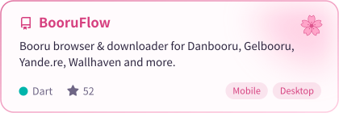
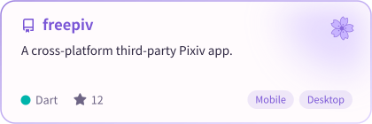
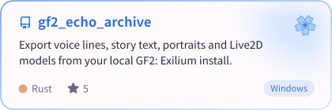
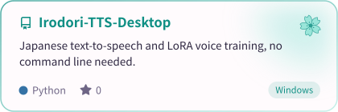
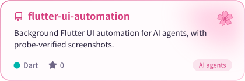
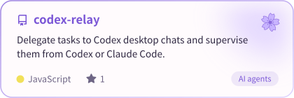

<picture>
  <source media="(prefers-color-scheme: dark)" srcset="assets/banner-dark.svg">
  
</picture>

 

<picture>
  <source media="(prefers-color-scheme: dark)" srcset="assets/about-dark.svg">
  
</picture>

<h3>⋆｡˚ ✿ tech stack ✿ ˚｡⋆</h3>

<picture>
  <source media="(prefers-color-scheme: dark)" srcset="https://skillicons.dev/icons?i=flutter%2Cdart%2Crust%2Cpython%2Cjs&perline=5&theme=dark">
  
</picture>

<h3>⋆｡˚ ✿ things I made ✿ ˚｡⋆</h3>

<!-- cards:start -->

<a href="https://github.com/normalllll/BooruFlow"><picture><source media="(prefers-color-scheme: dark)" srcset="assets/cards/BooruFlow-dark.svg"></picture></a>
<a href="https://github.com/normalllll/freepiv"><picture><source media="(prefers-color-scheme: dark)" srcset="assets/cards/freepiv-dark.svg"></picture></a>
 
<a href="https://github.com/normalllll/gf2_echo_archive"><picture><source media="(prefers-color-scheme: dark)" srcset="assets/cards/gf2_echo_archive-dark.svg"></picture></a>
<a href="https://github.com/normalllll/Irodori-TTS-Desktop"><picture><source media="(prefers-color-scheme: dark)" srcset="assets/cards/Irodori-TTS-Desktop-dark.svg"></picture></a>
 
<a href="https://github.com/normalllll/flutter-ui-automation"><picture><source media="(prefers-color-scheme: dark)" srcset="assets/cards/flutter-ui-automation-dark.svg"></picture></a>
<a href="https://github.com/normalllll/codex-relay"><picture><source media="(prefers-color-scheme: dark)" srcset="assets/cards/codex-relay-dark.svg"></picture></a>

<!-- cards:end -->

  

<picture>
  <source media="(prefers-color-scheme: dark)" srcset="assets/footer-dark.svg">
  
</picture>
